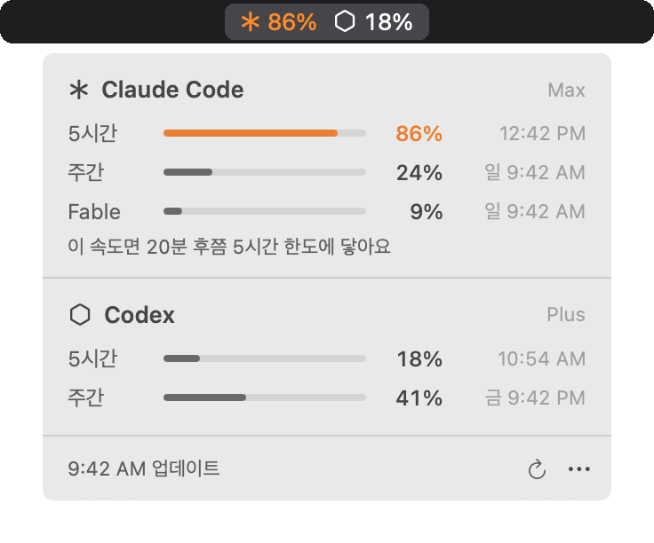
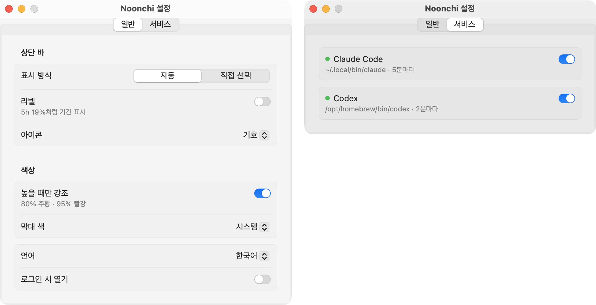

# Noonchi (눈치)

[English](README.md) | **한국어**

Claude Code와 Codex의 **사용 한도**를 macOS 상단 바에 숫자로 보여주는 앱입니다. 패널에서는 서비스마다 모든 한도(5시간, 주간, Fable 같은 모델별 주간, Codex의 30일 등)와 초기화 시각을 한 줄씩 보여줍니다.

<picture>
  <source media="(prefers-color-scheme: dark)" srcset="docs/images/panel-ko-dark.png">
  
</picture>

<sub>예시 값입니다.</sub>

## 특징

- **숫자가 상단 바에 바로 보입니다.** 기본값은 서비스마다 5시간 한도 하나이고(5시간 한도가 없으면 가장 짧은 한도), 80% 이상이면 주황, 95% 이상이면 빨강으로 바뀝니다.
- **인증 정보를 읽지 않습니다.** 키체인, 브라우저 쿠키, `~/.claude`·`~/.codex`의 인증 파일, 대화 로그 어디에도 접근하지 않습니다. 공식 `claude`·`codex` CLI가 보여주는 값을 씁니다.
- **앱이 직접 네트워크를 쓰지 않습니다.** 서버와 통신하는 것은 각 CLI이고, 앱에는 네트워크 코드나 자동 업데이트가 없습니다.
- **화면 갱신까지 반영해 읽습니다.** Claude Code의 `/usage`는 캐시 값을 먼저 그린 뒤 바뀐 숫자만 덮어씁니다. Noonchi는 출력을 가상 터미널 화면에 다시 그려 최종 값을 읽습니다. 실측 30회 중 23회에서 이전 방식(출력 문자열만 읽기)이 갱신 전 값을 읽었고, 지금 방식은 30회 모두 Claude Code 화면과 일치했습니다.
- **한도에 먼저 닿을 것 같으면 알려줍니다.** 지금까지의 속도로 초기화 전에 한도에 닿을 때만 패널에 한 줄("이 속도면 3:10 PM쯤 5시간 한도에 닿아요")을 띄웁니다. 기록을 남기지 않고 현재 값만으로 계산합니다.

측정 방법과 원자료: [`docs/benchmark.md`](docs/benchmark.md)

알아둘 점:
- Claude Code는 조회할 때마다 한 번 실행되므로 CPU를 1회 약 3.5초 씁니다(5분 간격이면 1시간에 약 40초). Codex는 `codex app-server`에 한 번 묻는 방식이라 1회 약 0.2~0.3초입니다(2분 간격).
- 앱 메모리 약 24MB(1시간 측정, 증가 없음)는 v0.3 기준입니다.
- Claude Code가 Noonchi 작업 폴더(`~/Library/Application Support/Noonchi`)를 `~/.claude.json`의 프로젝트 목록에 기록합니다. Noonchi가 직접 쓰는 것은 아닙니다.
- 자동 업데이트가 없습니다. CLI 출력 형식이 바뀌면 직접 업데이트해야 합니다.

## 설정

패널 아래 `⋯` › 설정에서 엽니다. 설정은 자동 저장됩니다.



| 탭 | 항목 | 옵션 |
|---|---|---|
| 일반 | 상단 바 표시 방식 | 자동(서비스마다 5시간 한도) / 직접 선택(서비스 탭에서 항목 선택) |
| | 라벨 | 끔 `19%` / 켬 `5h 19%` |
| | 아이콘 | 기호 / 글자 / 링(사용률만큼 차는 링) |
| | 높을 때만 강조 | 80% 주황, 95% 빨강 (기본 켬) |
| | 막대 색 | 시스템 / 프리셋 7가지 |
| | 언어 | 한국어 / English (기본값은 시스템 언어) |
| | 로그인 시 열기 | 켜면 macOS 로그인 항목에 등록 |
| 서비스 | 서비스별 | 감지 상태와 경로, 켜기/끄기, 직접 선택일 때 상단 바 항목 |

v0.3에서 상단 바 항목을 직접 골랐다면 업데이트 후에도 같은 화면이 나오도록 "직접 선택"으로 옮겨집니다.

## 동작 방식

- **Claude Code**: 5분마다(그리고 잠자기에서 깨어날 때) 백그라운드에서 `claude`를 가상 터미널(PTY)로 실행해 `/usage`를 보내고, 갱신이 끝난 화면을 읽은 뒤 바로 종료합니다. 모델을 호출하지 않으므로 **토큰을 쓰지 않습니다.** 작업 폴더는 `~/Library/Application Support/Noonchi`입니다.
- **Codex**: 2분마다 `codex app-server`를 실행해 `account/rateLimits/read`로 한도를 묻고 종료합니다. 이메일을 돌려주는 `account/read`는 호출하지 않고, 응답의 계정 ID는 지운 뒤 씁니다.
- 서비스마다 따로 조회하므로 한쪽이 느려도 다른 쪽은 갱신됩니다. 조회에 실패하면 마지막으로 읽은 값을 흐리게 두고 이유를 한 줄 표시합니다.
- 설치되지 않은 서비스는 조회하지 않고 패널에도 나오지 않습니다.

## 요구 사항

- macOS 14 이상, Apple Silicon(arm64)
- Claude Code(Pro/Max 구독) 또는 Codex(ChatGPT 로그인) 중 하나 이상 설치 및 로그인
- 빌드 시 Xcode 또는 Command Line Tools (Swift 5.9+)

`claude`는 `~/.local/bin`, `~/.claude/local`, `/opt/homebrew/bin`, `/usr/local/bin` 순서로, `codex`는 `/opt/homebrew/bin`, `/usr/local/bin`, `~/.local/bin`, `~/.npm-global/bin` 순서로 찾습니다. 다른 곳에 있다면 `NOONCHI_CLAUDE_PATH`, `NOONCHI_CODEX_PATH` 환경 변수로 지정하세요.

## 설치

**소스에서 빌드 (권장).** Xcode 또는 Command Line Tools가 필요합니다.

```bash
git clone https://github.com/Ja-efan/Noonchi.git
cd Noonchi
make install      # 빌드 → ~/Applications 설치 → 실행
```

**내려받기.** [Releases](https://github.com/Ja-efan/Noonchi/releases/latest)에서 `Noonchi-x.y.z.zip`을 받아 압축을 풀고 `Noonchi.app`을 `~/Applications`로 옮깁니다. Apple 공증을 받지 않은 앱이라 첫 실행이 막힙니다. 한 번 실행을 시도한 뒤 시스템 설정 › 개인정보 보호 및 보안에서 **그래도 열기**를 누르세요.

로그인 시 자동 실행은 설정 › 일반 › "로그인 시 열기"로 켭니다.

## 개발

| 명령 | 설명 |
|---|---|
| `make build` | 디버그 빌드 |
| `make test` | 단위 테스트 |
| `make app` | `dist/Noonchi.app` 및 zip 생성 |
| `make run` | 앱 빌드 후 실행 |
| `make clean` | 빌드 결과 삭제 |

Xcode에서 열려면 `open Package.swift`.

### 구조

```
Sources/
  UsageCore/            UI 없는 핵심 로직 (테스트 대상)
    Model/                공통 사용량 모델 (ProviderUsage, UsageWindow, ProviderState)
    Providers/            UsageProvider 프로토콜과 등록 목록
      ClaudeCode/           PTY로 claude 실행, /usage 전송, 사용률·플랜·초기화 시간 파싱
      Codex/                codex app-server에 JSON-RPC로 한도 조회
    Runtime/              PTY 프로세스, JSON-RPC 프로세스, 가상 화면 재현, ANSI 정리
    Presentation/         상단 바 문구, 강조 규칙, 도달 예측, 설정 이전
  Noonchi/              SwiftUI 메뉴 막대 앱 (패널, 상단 바 이미지, 설정, 다국어 문구)
Tests/UsageCoreTests/   단위 테스트와 녹화한 CLI 출력 샘플(Fixtures)
Resources/Info.plist    앱 번들 정보 (버전은 빌드 시 주입)
scripts/                앱 번들 빌드·설치 스크립트
```

### CLI 출력이 바뀌었을 때

1. 패널의 `⋯` › "원본 출력 보기"를 눌러 별도 창에서 내용을 복사합니다.
2. `Tests/UsageCoreTests/Fixtures/`에 새 샘플로 저장하고 테스트를 추가합니다.
3. 해당 서비스의 파서(Claude Code는 `UsageParser.swift`, Codex는 `RateLimitsDecoding.swift`)를 고쳐 테스트를 통과시킵니다.

### 서비스 추가

`Providers/` 아래에 `UsageProvider`를 따르는 타입(CLI 찾기, 창 목록 반환)을 만들고, `Providers.all`에 한 줄 추가하고, fixture 테스트를 붙입니다. 패널, 상단 바, 설정은 창 목록만 보므로 고칠 필요가 없습니다.

## 릴리스

`VERSION`을 올리고 태그를 푸시하면 GitHub Actions가 테스트, 빌드 후 zip을 Release에 올립니다.

```bash
git tag v0.1.0 && git push origin v0.1.0
```

배포된 앱은 ad-hoc 서명이고 공증을 받지 않았습니다. 첫 실행 방법은 [설치](#설치)를 참고하세요.

## 라이선스

MIT
