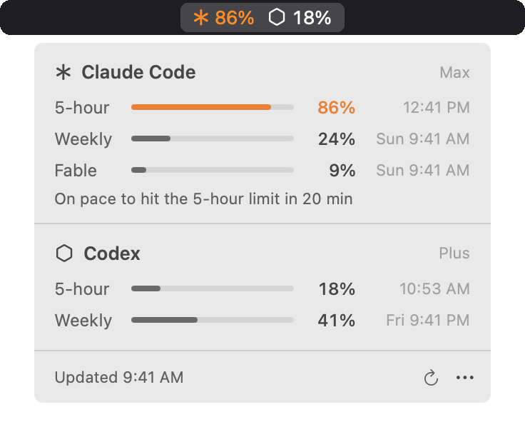
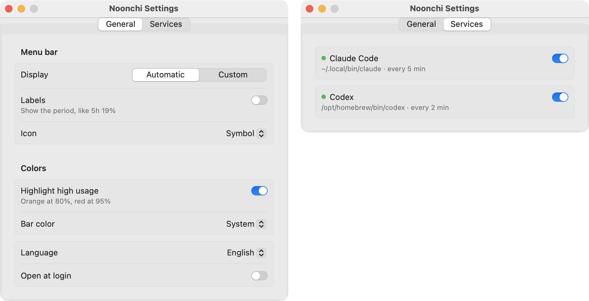

# Noonchi (눈치)

**English** | [한국어](README.ko.md)

*Noonchi* (눈치) is the Korean knack for reading the room. This app reads your Claude Code and Codex usage limits so you can see them before you hit them.

Noonchi shows the limits as numbers in the macOS menu bar. The panel lists every limit of each service on one line — 5-hour, weekly, per-model weekly caps such as Fable, Codex's 30-day window — with its reset time.

<picture>
  <source media="(prefers-color-scheme: dark)" srcset="docs/images/panel-en-dark.png">
  
</picture>

<sub>Sample values.</sub>

## Features

- **The numbers are right in the menu bar.** By default each service shows its 5-hour limit (or its shortest one if it has none). It turns orange at 80% and red at 95%.
- **It never reads your credentials.** No Keychain, no browser cookies, no auth files under `~/.claude` or `~/.codex`, no conversation logs. It uses what the official `claude` and `codex` CLIs report.
- **The app only goes online when you ask.** Only the CLIs talk to their servers for usage. The app connects to GitHub only when you choose Check for Updates or Install, and it sends nothing about you.
- **It reads the screen after it finishes updating.** Claude Code's `/usage` first draws cached numbers, then overwrites only the digits that changed. Noonchi replays the output on an emulated terminal screen and reads the final values. In 30 real captures, the old approach (reading the output as plain text) returned the pre-refresh value 23 times; the current approach matched Claude Code's screen all 30 times.
- **It warns you when you're on track to hit a limit.** Only when your pace so far would reach a limit before it resets, the panel shows one line ("On pace to hit the 5-hour limit by 3:10 PM"). It keeps no history; it works from the current values.

Method and data: [`docs/benchmark.md`](docs/benchmark.md) (in Korean)

Good to know:
- Each Claude Code refresh launches Claude Code once, which costs about 2.6 s of CPU (about 30 s per hour at the default 5-minute interval). A Codex refresh asks `codex app-server` once, about 0.2–0.3 s. Set a longer interval in Settings to use less. Refreshes are skipped while the screen is off.
- The app itself uses about 26 MB of memory and 3 s of CPU per hour with both services at their old intervals (measured over one hour; memory went from 20 MB to 26 MB).
- Claude Code records Noonchi's working folder (`~/Library/Application Support/Noonchi`) in the project list in `~/.claude.json`. Noonchi doesn't write that file itself.
- Noonchi doesn't check for updates by itself. If a CLI changes its output, you'll need a new version.

## Settings

Open them from `⋯` › Settings at the bottom of the panel. Changes are saved automatically.



| Tab | Setting | Options |
|---|---|---|
| General | Display | Automatic (each service's 5-hour limit) / Custom (pick items in the Services tab) |
| | Show | Used `19%` / Remaining `81%`. Colors always follow usage |
| | Labels | Off `19%` / on `5h 19%` |
| | Icon | Symbol / Letter / Ring (fills to the shown number) |
| | Highlight high usage | Orange at 80%, red at 95% (on by default) |
| | Bar color | System / 7 presets |
| | Refresh every | 1 to 120 minutes (default 5). Longer uses less CPU, but limit warnings can come later |
| | Language | 한국어 / English (defaults to the system language) |
| | Open at login | Registers Noonchi as a macOS login item |
| Services | Each service | Detection status and path, on/off, menu bar items in Custom mode |

If you picked menu bar items in v0.3, they move to Custom so the menu bar looks the same after updating.

## How it works

- **Claude Code**: at each refresh, it runs `claude` in a pseudo-terminal (PTY) in the background with your MCP servers turned off for that run (`--strict-mcp-config`), sends `/usage`, reads the screen once the refresh is done, and quits it. It never calls a model, so **it uses no tokens.** Claude Code runs in `~/Library/Application Support/Noonchi`.
- **Codex**: at each refresh, it runs `codex app-server`, asks `account/rateLimits/read`, and quits it. It never calls `account/read` (which returns your email), and it drops the account ID from the response.
- It refreshes at the interval you set, on launch, on wake from sleep, and when the screen comes back. Each service reads on its own, so a slow one doesn't hold up the other. If a refresh fails, the last values stay, dimmed, with a one-line reason.
- Services that aren't installed aren't polled or shown.

## Requirements

- macOS 14 or later, Apple Silicon (arm64)
- Claude Code (Pro/Max subscription) or Codex (ChatGPT sign-in), installed and signed in
- Xcode or the Command Line Tools to build (Swift 5.9+)

Noonchi looks for `claude` in `~/.local/bin`, `~/.claude/local`, `/opt/homebrew/bin`, and `/usr/local/bin`, and for `codex` in `/opt/homebrew/bin`, `/usr/local/bin`, `~/.local/bin`, and `~/.npm-global/bin`, in that order. If yours is elsewhere, set `NOONCHI_CLAUDE_PATH` or `NOONCHI_CODEX_PATH`.

## Install

**Build from source (recommended).** Needs Xcode or the Command Line Tools.

```bash
git clone https://github.com/Ja-efan/Noonchi.git
cd Noonchi
make install      # build → install to ~/Applications → launch
```

**Download.** Get `Noonchi-x.y.z.zip` from [Releases](https://github.com/Ja-efan/Noonchi/releases/latest), unzip it, and move `Noonchi.app` to `~/Applications`. The app isn't notarized by Apple, so macOS blocks the first launch: try to open it once, then click **Open Anyway** in System Settings › Privacy & Security.

To start it at login, turn on Settings › General › "Open at login".

### Updating

Choose `⋯` › Check for Updates in the panel. If there's a new version, Install downloads it from GitHub Releases, replaces the app, and reopens it. Your settings stay. If you built from source, you can also run `git pull && make install`.

Updates aren't notarized or separately signed. The app checks the download's SHA-256, bundle ID, and code signature.

## Development

| Command | Description |
|---|---|
| `make build` | Debug build |
| `make test` | Unit tests |
| `make app` | Build `dist/Noonchi.app` and a zip |
| `make run` | Build the app and run it |
| `make clean` | Remove build output |

To open it in Xcode, run `open Package.swift`.

### Layout

```
Sources/
  UsageCore/            Core logic with no UI (tested)
    Model/                Shared reading model (ProviderUsage, UsageWindow, ProviderState)
    Providers/            UsageProvider protocol and registry
      ClaudeCode/           Runs claude in a PTY, sends /usage, parses usage, plan, and reset times
      Codex/                Asks codex app-server for rate limits over JSON-RPC
    Runtime/              PTY process, JSON-RPC process, screen replay, ANSI cleanup
    Presentation/         Menu bar text, highlight rule, pace prediction, settings migration
  Noonchi/              SwiftUI menu bar app (panel, menu bar image, settings, localized strings)
Tests/UsageCoreTests/   Unit tests and recorded CLI output samples (Fixtures)
Resources/Info.plist    App bundle info (version injected at build time)
scripts/                App bundle build and install scripts
```

### When a CLI's output changes

1. Open "Show raw output" from `⋯` in the panel and copy the text from the window that opens.
2. Save it as a new sample in `Tests/UsageCoreTests/Fixtures/` and add a test.
3. Fix the service's parser (`UsageParser.swift` for Claude Code, `RateLimitsDecoding.swift` for Codex) until the test passes.

### Adding a service

Add a type under `Providers/` that conforms to `UsageProvider` (find the CLI, return a list of windows), add it to `Providers.all`, and add a fixture test. The panel, menu bar, and settings work from the window list, so they need no changes.

## Releases

Bump `VERSION` and push a tag. GitHub Actions runs the tests, builds the app, and attaches the zip to a Release.

```bash
git tag v0.1.0 && git push origin v0.1.0
```

Released builds are ad-hoc signed and not notarized; see [Install](#install) for the first launch.

## License

MIT
